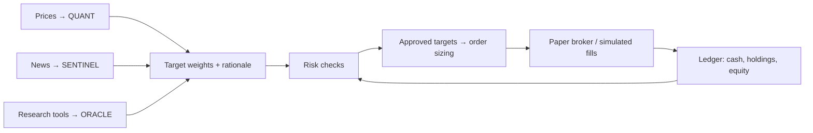

# Trident

**A paper-trading research system that routes three kinds of investment signals through the same risk and execution pipeline.**

## Run the offline demo

With [uv](https://docs.astral.sh/uv/) installed, run these commands from the repository root:

```sh
uv sync --locked --python 3.12 --extra dev --extra oracle
uv run --no-sync python scripts/demo.py
```

The demo starts with $10,000 in simulated cash. A fixed strategy targets a 10% position and the risk engine approves a buy of 10 shares. The simulator fills it at $100.05 after 5 basis points of slippage and the ledger marks it at each session close. It runs offline after the dependency install and needs no credentials, database, or brokerage account.

| Session | Simulated fill | Closing equity |
| --- | --- | ---: |
| 2024-03-01 | Buy 10 AAPL at $100.05 | $10,019.50 |
| 2024-03-04 | Hold | $10,039.50 |
| 2024-03-05 | Hold | $10,009.50 |

The demo uses invented prices and a fixed policy. These values illustrate accounting and order flow.

## How it works

| Agent | Signal | Where to look |
| --- | --- | --- |
| **QUANT** | Price and volume features feed systematic rules and a walk-forward model experiment. | [Baselines](src/trident/agents/quant/baselines.py) · [Feature code](src/trident/agents/quant/features.py) |
| **SENTINEL** | News and social signals are filtered for relevance before sentiment is aggregated by ticker. | [Ingestion](src/trident/data/news.py) · [Aggregation](src/trident/agents/sentiment/aggregate.py) |
| **ORACLE** | An LLM builds research theses from tools. Citation checks compare numeric claims to the supplied evidence before portfolio sizing. | [Research graph](src/trident/agents/analyst/graph.py) · [Citation checks](src/trident/agents/analyst/citations.py) |



The [paper runner](src/trident/orchestration/runner.py) records decisions before risk review. The [execution service](src/trident/execution/service.py) logs orders before submission, then persists the fills. The [backtester](src/trident/evaluation/backtest.py) shares the risk, sizing, and ledger code with the paper path and simulates execution using the session open. The strategy’s price history stops at the previous session, while the book snapshot marks held positions at the current open.

## Engineering highlights

- [Backtest tests](tests/test_backtest.py) pin a hand-calculated equity curve and catch look-ahead leakage.
- [Risk tests](tests/test_risk.py) cover rejection and resizing. [Turnover authorization](src/trident/risk/turnover.py) separately models gross filled and outstanding exposure with exact decimal arithmetic. It has its own [test suite](tests/test_turnover.py).
- [Oracle citation tests](tests/test_oracle_citations.py) check numeric evidence and derived values. [Engineering notes](docs/08_ROADMAP.md) explain the later research on evidence, recovery, and decision provenance.

Run the same checks as CI:

```sh
uv run --no-sync ruff format --check .
uv run --no-sync ruff check .
uv run --no-sync pytest -q -m "not integration"
```

[Optional local services and isolated integration tests](docs/09_OPERATIONS.md) · [Architecture details](docs/01_ARCHITECTURE.md) · [Evaluation design](docs/07_EVALUATION.md)
